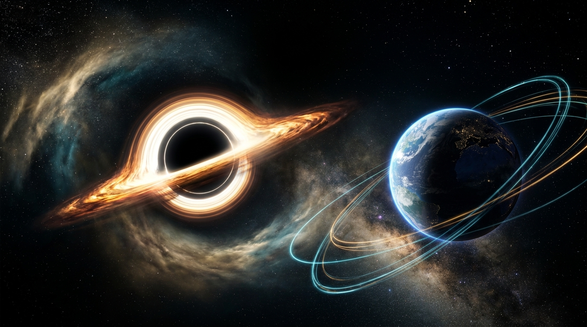

<p align="center">
  
</p>

# Cosmos IX — Relativistic Astrophysics & 3D Observatory (Android)

**Cosmos IX** is a native Android **Kotlin + Jetpack Compose + OpenGL ES 3.0** relativistic space simulator, Kerr black hole laboratory, helical solar vortex visualizer, and live Earth-sky observatory featuring an Arabic RTL luxury observatory interface.

> **Automatic APK Downloads:** Every push to `main` triggers the included GitHub Actions workflow (`.github/workflows/build-apk.yml`) to run unit tests and publish an installable **`CosmosIX-debug.apk`** automatically under your repository's **Releases** and **Actions → Artifacts**.

---

## Key Features

### 1. Solar System 8K (`الفضاء`)
- **High-Precision Ephemeris:** Powered by **CosineKitty Astronomy Engine (`2.1.19`)** implementing **VSOP87** planetary series, **ELP/MPP02** lunar positions, and apparent visual magnitudes.
- **60/120 FPS Continuous Render Clock:** Simulation time integrates directly on the OpenGL render thread at full VSync frame rate with stabilized frame deltas, smooth acceleration/braking, touch fling inertia, and zero-lag target-locked camera tracking with quintic `SmootherStep` body-to-body flight.
- **Physically Inspired Planet Rendering:** Procedural + streaming NASA textures, atmospheric Rayleigh/Mie Fresnel rim shells, Earth clouds & glowing city night-lights, Saturn & Uranus rings, Jupiter's Great Red Spot, 5,000-body Keplerian asteroid belt, Einstein spacetime curvature grid, and automatic sunlit 3/4 terminator hero framing.

### 2. Helical Solar Vortex (`الحلزونية`)
- Visualizes the Solar System's **230 km/s (828,000 km/h)** trajectory toward the Solar Apex (Vega) using **3D volumetric camera-facing plasma ribbons** backed by a zero-allocation sliding-window cache (`HelicalTrailCache`) for >95% CPU savings.
- Includes a glowing **Heliosphere Bow-Shock** paraboloid, galactic velocity star-streaks, automatic cinematic vortex speed (`30 days/sec`), and a live distance-traveled telemetry HUD.

### 3. Kerr Black Hole Laboratory (`الثقب الأسود`)
- Fullscreen **OpenGL ES 3.0 geodesic ray-marcher** with volumetric 3D accretion torus, asymmetric Doppler beaming, sharp Einstein photon ring, optional relativistic polar jets, and precessing **Star S2** rosette orbit.
- Presets for **Sagittarius A\***, **M87\***, and **Cygnus X-1**, interactive spin ($a_*$) and accretion controls, **Dive to Event Horizon** mode, and **Dual Relativistic Clocks** (Spacecraft proper time $d\tau$ vs. Earth coordinate time).

### 4. Live Earth Sky Observatory (`سماؤك الآن`)
- Topocentric horizon coordinates with atmospheric refraction (`Refraction.Normal`) and aberration via Astronomy Engine for 12 global & Middle Eastern cities.
- Renders real **Moon phase & illumination** oriented to the Sun, 5 naked-eye planets, 40 Hipparcos bright stars with Arabic names, 8 constellations, animated meteors, mountain/city horizon panorama, live weather cloud cover (Open-Meteo), gyroscope sky-pointing, live azimuth compass, and local sunrise/sunset times.

### 5. Milky Way 3D (`درب التبانة`)
- 3D volumetric barred-spiral galactic core disc, multi-arm starfield, and pulsing Solar System location beacon.

### Audio, Cinema & Performance Architecture
- **Linear HDR Range Scaling Bloom:** Works cleanly on both `RGBA16F` hardware GPUs and `RGBA8` emulated/virtualized GPUs without color clipping.
- **Adaptive Resolution Governor:** Dynamically tunes internal render scale and shader step budgets on software GPUs to prevent EGL fence stalls.
- **8D Spatial Audio Engine:** Synthesized procedural ambient soundscape reacting to camera yaw and black hole proximity.
- **Cinema Mode & High-Res Snapshot Capture.**

---

## Tech Stack

| Layer | Technology |
| :--- | :--- |
| Language | Kotlin (`2.4.21`) |
| UI Framework | Jetpack Compose + Material 3 (RTL Arabic) |
| 3D Graphics | OpenGL ES 3.0 (`GLSurfaceView`, custom GLSL ES 3.00 shaders) |
| Ephemeris & Astronomy | `com.github.cosinekitty:astronomy:2.1.19` (via JitPack) |
| Persistence & Networking | Jetpack DataStore Preferences, OkHttp (Open-Meteo weather & textures) |
| Concurrency | Kotlin Coroutines & `StateFlow` |
| Testing | JUnit 4 + Robolectric (`4.16.1`) + Compose UI Test |
| Android SDK | `minSdk = 24`, `targetSdk = 36`, `compileSdk = 36.1`, Java 11 |

---

## Project Structure

```text
├── app/src/main/java/com/example/
│   ├── MainActivity.kt                  # Edge-to-edge activity host
│   ├── audio/SpatialAudio8DEngine.kt    # Procedural 8D spatial audio
│   ├── data/                            # Preferences, Open-Meteo weather, texture & snapshot loaders
│   ├── domain/
│   │   ├── AstrophysicsEngine.kt        # VSOP87/ELP-MPP02/NOVAS & Kerr GR engine
│   │   └── CosmosModels.kt              # Immutable UI & telemetry state models
│   ├── engine/
│   │   ├── CosmosGlRenderer.kt          # 60/120 FPS OpenGL ES 3.0 renderer
│   │   ├── CosmosGlSurfaceView.kt       # Touch/pinch/double-tap GL viewport
│   │   ├── HelicalTrailCache.kt         # Sliding-window C0-continuous helical ribbon cache
│   │   ├── HdrBloomPipeline.kt          # Dual-pass Linear HDR Bloom & ACES tonemapper
│   │   ├── GlGeometry.kt & GlUtils.kt   # Procedural VAO meshes & GL helpers
│   │   └── ShaderPrograms.kt / VortexAndSkyShaders.kt
│   ├── sensors/SkyGyroscopeController.kt
│   ├── ui/                              # Compose screens, HUD cards, drawers & theme
│   └── viewmodel/CosmosViewModel.kt     # Lifecycle-aware MVVM state controller
└── app/src/test/java/com/example/
    ├── AstrophysicsEngineTest.kt        # Ephemeris, Kerr GR & 60 FPS trail continuity tests
    └── ExampleRobolectricTest.kt        # Compose UI mode switching & repository tests
```

---

## Getting Started

### Prerequisites
- **Android Studio** (Meerkat / Narwhal or newer with AGP 9.x support)
- **JDK 11+**
- **Android SDK 36** (and Android device/emulator supporting **OpenGL ES 3.0**)
- Internet access on first build to fetch Gradle dependencies (including JitPack for `astronomy:2.1.19`).

### Build & Run Locally
1. Clone the repository:
   ```bash
   git clone https://github.com/<YOUR_USERNAME>/<YOUR_REPO_NAME>.git
   cd <YOUR_REPO_NAME>
   ```
2. Open the folder in **Android Studio** and allow Gradle sync to complete.
3. Select an Android device or emulator (API 24+, OpenGL ES 3.0) and click **Run**, or build via CLI:
   ```bash
   ./gradlew :app:assembleDebug
   ```
   *(If building inside a system-installed Gradle environment without a wrapper jar, run `gradle :app:assembleDebug`.)*

### Run Unit & UI Tests (JVM / Robolectric — No Emulator Required)
```bash
./gradlew :app:testDebugUnitTest
```
Covers Kerr general relativity metrics, VSOP87 planetary radii, lunar phase/sunrise-sunset calculations, 60 FPS `HelicalTrailCache` continuity, Open-Meteo JSON parsing, and Compose mode-switching CUJs.

---

## Secrets & Signing Note
- No API keys are required to build or run **Cosmos IX** (weather uses the keyless Open-Meteo public API, and all astronomy math runs locally on-device).
- `.env`, `local.properties`, `debug.keystore`, and `*.jks` release keystores are excluded via `.gitignore` so private credentials are never committed.

---

## License
Specify your preferred license (e.g., MIT or Apache 2.0) in a `LICENSE` file before public distribution.
